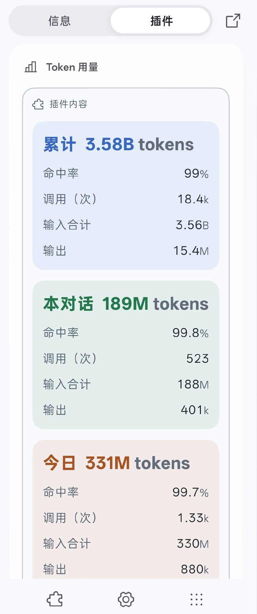
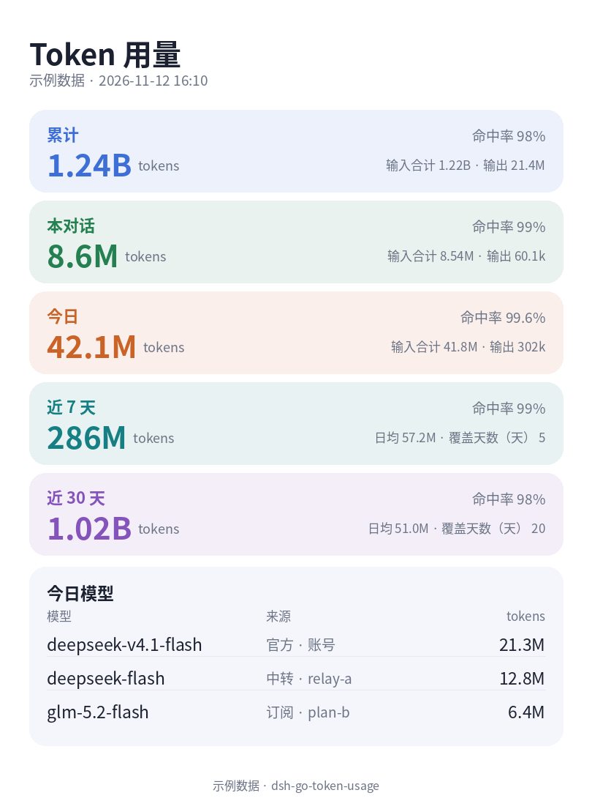

# dsh-go-token-usage

[中文](README.md) | English

Native token usage for the [dsh-go](https://github.com/ccch1mneyyy/dsh-Go) phone app: a status strip above the composer, a panel in the chat's Plugins tab, a note under every reply, and a generated usage card. Every number comes from this host's own session logs — no network, no estimates.

<p align="center">
  
</p>

The generated usage card (sample data):

<p align="center">
  
</p>

## Features

| Where | What |
|---|---|
| Status strip | `Chat 8.8M · today 245M`; tap to open the panel |
| Panel | All time / this chat / today / last 7 days / last 30 days, hit rate, daily average, days covered, today's models labelled official / relay / subscription |
| Turn note | Tokens and cache hits of each reply |
| Generate image | Draws a portrait card on the host and shows it at the bottom of the panel (a placeholder until you export) — screenshot to share (needs `python3` + Pillow) |
| Verify | Re-counts the raw logs and compares with the panel |

## Install

```sh
npx dsh-go-token-usage install
```

or straight into a profile:

```sh
dsh plugin --profile web add dsh-go-token-usage
```

On a remote host (server / PC) prefer the installer above, or install the dsh-go bridge first — without it the native surfaces are not rendered. Re-running the installer upgrades an older install; `--force` reinstalls. Then switch hosts (or reopen the app) once so it re-reads the plugin inventory.

## Notes

- **Needs the dsh-go bridge**: native surfaces only render on hosts that serve it — the phone's own engine ships it; for a remote host run `npx dsh-go-token-usage install` (the installer downloads the bridge from upstream GitHub). **DSH Remote** connections do not show them.
- **Re-read after install**: switch hosts in the app (or reopen it). Manifest changes are picked up automatically; changes under `lib/` need an engine restart.
- **Generate image**: needs `python3` + Pillow and a CJK font on the host (Noto CJK / WenQuanYi / Microsoft YaHei / PingFang; otherwise Chinese labels are tofu). It tells you when Python/Pillow is missing. Drawing is deferred, so a slow render does not lose the tap. The card shows only in the chat that generated it; PNGs stay in the package's `assets/` (latest three kept, and images other chats are still showing are protected). There is no long-press save in the app, so screenshot it.
- **This host only**: counts this `$DSH_HOME`; other hosts count separately. Subagents count in the windows and total, not in "this chat".
- **First run takes a few seconds**: the initial scan of existing sessions takes about 5–10 s depending on log size; numbers appear shortly after.
- **Dashes**: a relay that does not report cache counters shows "—" for that chat's / period's hit rate (a mixed host never reads a relay as 0%); unreported reasoning shows "—".
- **Logs can vanish without zeroing history**: everything the plugin has read is kept in its own cache, so cleaning up logs or deleting a chat keeps the numbers and the panel says "N log(s) gone — history kept from cache". Logs that vanished before the plugin ever read them (for example, cleaned up before installing) cannot be recovered; the panel then says "No session logs here — live calls only" instead of silently showing 0. Switching `$DSH_HOME` means a different ledger; days follow the host's local time zone.

## Compatibility

- Plugin host half: DSH `0.2.1-rc.2` – `0.2.x` (`assistant/attempt`, `message.source`, `session/end-seed` exist since 0.2.1-rc.2); tested on DSH 0.2.2-rc.1;
- the native surfaces additionally need the dsh-go bridge (adapted and verified against `@deepseek-ai/dsh-web-app@0.2.2-rc.1`): the phone's own engine ships it, the installer adds it to a remote host;
- Node 22.19+ (uses the `zlib` zstd decoder; DSH 0.2.2 itself requires Node 24.9+);
- native surfaces do not show over DSH Remote connections (app limitation).

## Privacy

No account, key or credential is read, and nothing is sent over the network at runtime. It only reads the `usage` counters and model names from `$DSH_HOME/sessions` (never message bodies); exported images stay on this host.

<details>
<summary>Details and known limits</summary>

- Totals: `tokens = uncached input + cache reads + cache writes + output`, matching the engine's own token-usage projection; hit rate = cache reads ÷ prompt tokens;
- Retried/failed model calls count too (the engine counts them): the last usage sample of that `assistant/attempt` stream; a re-settlement of the same turn+step replaces the previous one, while a settlement after `llm/retry-started` is a new call; compaction summaries are not counted (the engine does not count them either);
- "This chat" counts the session itself; subagent calls count in the windows and the total;
- Fork/seed logs skip the inherited prefix (the `session/end-seed` marker), so nothing is counted twice; if the parent's own log is gone from this host, that prefix is not restored;
- Sessions are deduplicated by id: moving/copying `$DSH_HOME`, or one session appearing in two project directories, counts once;
- Logs are parsed zstd-frame by zstd-frame as a stream: decompressed memory stays bounded (the compressed file itself is read whole) and huge single frames are decoded incrementally;
- A relay that omits cache counters shows a dash instead of a fake 0%; unreported reasoning shows a dash too;
- The first run scans existing sessions (~5–10 s, depending on log size), then only changed files are read; the cache in `$DSH_HOME/cache/dsh-go-token-usage/index.json` holds numbers, model names, local session-file paths and live calls not yet flushed to disk;
- Each session prefers its newest format generation, but when that one is empty, shorter than what was already counted, or unreadable, the more complete one is kept so history never drops to zero (the panel then says "N log(s) unreadable"); when both `.jsonl` and `.jsonl.zstd` exist for the same version the newer file wins; older generations are never double-counted, and uncompressed logs (`compression: none`) are read too;
- History read before a log disappeared stays counted and is flagged as missing from disk (the panel and Verify both say so); the cache is version 8, so an older build ignores it and rescans instead of double-counting; a host timezone change re-reads the logs into the right days;
- Verify re-counts every log and compares per session: `Verified · …` when it matches; cached history whose log is gone is named separately (`N log(s) gone`) instead of a fake diff; with no session log folder at all it reports `Verify skipped`; only a real unexplained amount shows `Diff … tokens`.

</details>

## Uninstall

```sh
dsh plugin --profile web remove dsh-go-token-usage
```

<details>
<summary>Development / releasing</summary>

```sh
npm test
node "$DSH_HOME/skills/dsh-go-plugin/kit/bin/check.mjs" "$PWD" --load
node scripts/release.mjs 0.1.1   # bump + tag + push; Actions publishes to npm and creates the release
```

</details>

## License

MIT. The installer downloads `dsh-go-bridge` on demand from the upstream [ccch1mneyyy/dsh-Go](https://github.com/ccch1mneyyy/dsh-Go); this repository does not redistribute it.
