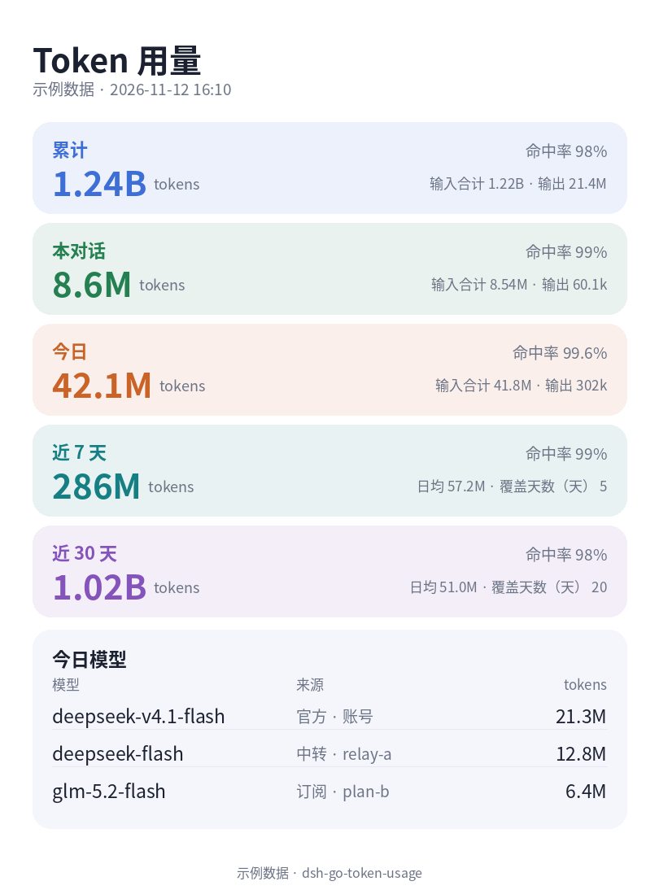

# dsh-go-token-usage

[English](README.en.md) | 中文

给 [dsh-go](https://github.com/ccch1mneyyy/dsh-Go) 手机 App 的原生 Token 用量插件：输入框上方的状态条、对话「插件」页签里的面板、每条回复的用量脚注，还能导出一张用量卡片。数字全部来自本机会话日志，不联网、不估算。



## 功能

| 位置 | 内容 |
|---|---|
| 状态条 | `本对话 8.8M · 今日 245M`，点开面板 |
| 面板 | 累计 / 本对话 / 今日 / 近 7 天 / 近 30 天；命中率、日均、覆盖天数；今日模型（标注官方 / 中转 / 订阅来源） |
| 回合脚注 | 每条回复这一轮的 tokens 与缓存命中 |
| 导出图片 | 主机画一张竖版卡片，直接显示在面板底部（未生成时是占位图），截图分享（需要 `python3` + Pillow） |
| 核对 | 用原始日志整卷重算，和面板数字对账 |

## 安装

```sh
npx dsh-go-token-usage install
```

或者直接装进 profile：

```sh
dsh plugin --profile web add dsh-go-token-usage@0.1.0
```

装完在 App 里切一下主机（或重开 App），让它重读插件清单。

## 注意事项

- **需要 dsh-go 桥接**：原生界面只在带桥接的主机上显示——手机本机引擎自带；远程主机用 `npx dsh-go-token-usage install` 装（会从上游 GitHub 下载桥接）。经 **DSH Remote** 连接时不显示。
- **装完要重读**：在 App 里切一下主机（或重开 App）；之后改清单（`package.json`）自动生效，改 `lib/` 里的代码要重启引擎。
- **导出图片**：主机需要 `python3` + Pillow，没有会提示；图片显示在面板底部，只留在本机插件包 `assets/`（保留最近 3 张），App 里不能长按保存，截图分享。
- **只算本机**：统计范围是本机 `$DSH_HOME` 的会话，换主机各算各的；子智能体计入「窗口 / 累计」，不计入「本对话」。
- **第一次慢几秒**：首次运行要扫一遍历史会话（约 5 秒），面板数字会稍后出现。
- **可能显示「—」**：中转不返回 cache 计数时命中率显示「—」；引擎不报推理 tokens 时推理显示「—」。
- **历史依赖日志**：删掉会话日志或换 `$DSH_HOME`，历史统计就没了；日期按主机本地时区分天。

## 兼容

- DSH `0.2.1-rc.2` ~ `0.2.x`；
- 需要主机上有 dsh-go 桥接：手机本机引擎自带，远程主机用安装器装；
- 经 DSH Remote 连接时不显示原生界面（App 限制）。

## 隐私

不读账号、密钥或任何凭据；运行时不联网。只读 `$DSH_HOME/sessions` 里的 usage 计数和模型名，不保存对话正文；导出的图片只存在本机。

<details>
<summary>细节与已知边界</summary>

- 口径：`tokens = 未缓存输入 + 缓存读取 + 缓存写入 + 输出`，与引擎记账一致；命中率 = 缓存读取 ÷ 提示词总量；
- 「本对话」只算当前会话自身，子智能体计入窗口与累计；
- fork/seed 会话的继承前缀按 `session/end-seed` 跳过，不重复计；
- 中转不返回 cache 字段时命中率显示「—」，推理未上报时显示「—」；
- 首次运行扫一遍历史会话（约 5 秒），之后增量更新；缓存 `$DSH_HOME/cache/dsh-go-token-usage/index.json` 只存数字、模型名和本机会话文件路径；
- 面板「核对」会把原始日志整卷重算：一致显示 `核对：一致 · …`，有未落盘调用显示 `核对：差 N 次`。

</details>

## 卸载

```sh
dsh plugin --profile web remove dsh-go-token-usage
```

<details>
<summary>开发 / 发布</summary>

```sh
npm test
node "$DSH_HOME/skills/dsh-go-plugin/kit/bin/check.mjs" "$PWD" --load
node scripts/release.mjs 0.1.1   # 改版本 + 打 tag + push；Actions 自动 npm publish 和 Release
```

</details>

## 许可

MIT。安装器会按需从上游 [ccch1mneyyy/dsh-Go](https://github.com/ccch1mneyyy/dsh-Go) 下载 `dsh-go-bridge`，本仓库不转存该代码。
